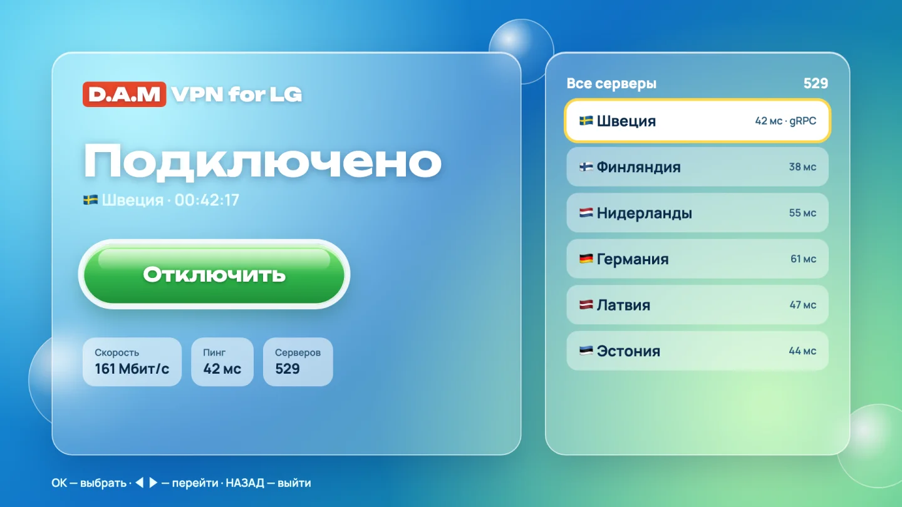
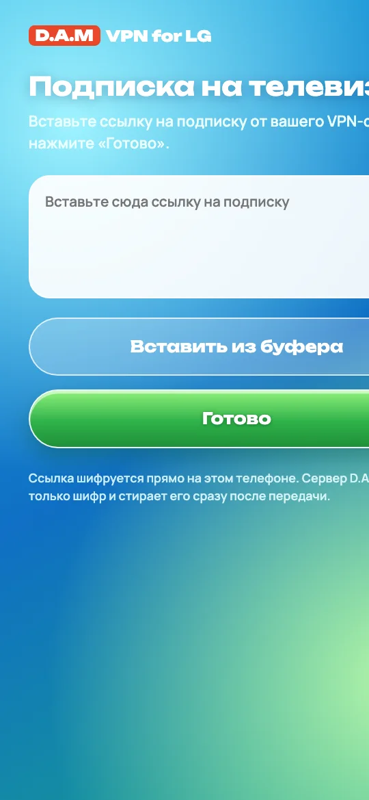

# D.A.M VPN for LG

[Русский](README.md) · **English**

A VPN for the whole LG webOS TV: YouTube, the browser and every app go through the VPN. A subscription from any VPN provider is added from your phone with a QR code — no typing with the remote.

<p> </p>

Product page: [damstudio.tech/vpn.html](https://damstudio.tech/vpn.html) · made by [D.A.M Studio](https://damstudio.tech)

## Features

- **The whole TV through the VPN.** All apps are tunnelled; the home network, casting from a phone and SSH stay direct.
- **DNS through the VPN too.** Helps when the router or ISP blocks sites at the DNS level (that was the case with YouTube).
- **Every server of the subscription.** VLESS with REALITY + Vision and with gRPC + TLS; an `https://` subscription link, a list of `vless://` links or base64.
- **Fast.** Up to 160 Mbit/s through the VPN on the test TV versus 176–181 Mbit/s without it.
- **Safe rollback.** Turning it off restores the TV network exactly; an automatic rollback kicks in if the connection to the TV is lost.
- **No secret leaks.** Subscription links and keys never reach the screen, logs or reports; when sent from the phone, the link is encrypted on the phone itself.

## Status

| Stage | What | Status |
|---|---|---|
| 1 | Engine: Xray on the TV, VLESS + gRPC + TLS check | done, tested on a TV |
| 2 | All TV traffic through the VPN (TUN), DNS through the VPN, rollback | done, tested on a TV |
| 3 | App with the "Glass" UI, QR subscription import, autostart, `.ipk` | version 0.1.0, tested on a TV |

Tested on LG 86UR81006LA, webOS TV 10.3.2 (webOS 25), rooted with Homebrew Channel.
## Installing on the TV

1. Download `com.damstudio.vpn_0.1.0_all.ipk` from [Releases](../../releases).
2. Install it with **webOS Dev Manager** (Install → choose the file), over **SSH** with `luna-send-pub … appInstallService/dev/install` (see the Russian README), or from a Mac with `stage1/mac/tvctl install-app`.
3. Open **D.A.M VPN** → "+ Подписка" → scan the QR code with your phone, paste your subscription link, tap "Готово".
4. Pick a server → "Подключить". The root background part is started automatically through Homebrew Channel.

If a VPN is on on your phone, the subscription page may not open — turn it off for a minute.

## Requirements

- An LG webOS TV with root (Homebrew Channel) and SSH enabled.
- A subscription from an Xray-based VPN provider (VLESS).
- For now, a Mac with `python3` and `ssh` on the same network as the TV.

## Quick start (for now, from a Mac)

```sh
cd stage1/mac
./tvctl selftest                       # checks on the Mac, no TV needed
./tvctl facts                          # TV facts (read-only)
./tvctl fetch linux-arm64-v8a          # Xray with a pinned SHA-256
umask 077; mkdir -p ~/.config/lg-tv-vpn
pbpaste > ~/.config/lg-tv-vpn/quattro.uri   # subscription link from the clipboard (historical file name)
./tvctl config --list && ./tvctl config --pick N && ./tvctl tun-config
./tvctl push linux-arm64-v8a && ./tvctl tun-start && ./tvctl tun-check
./tvctl tun-confirm                    # otherwise it rolls back after 5 minutes
./tvctl tun-stop                       # turn off and restore the network
```

Default TV address `root@192.168.1.146`; use `TV=root@ADDRESS ./tvctl …` for another. Docs (Russian): [stage1/RUNBOOK.md](stage1/RUNBOOK.md), [stage2/ПЛАН_TUN.md](stage2/ПЛАН_TUN.md).

## How it works

- **Engine** — [Xray-core](https://github.com/XTLS/Xray-core) from the official releases; version and SHA-256 pinned in `stage1/mac/fetch_xray.sh`.
- **TUN** `damvpn0` is created by Xray; traffic is steered by a separate routing table and `ip rule` entries 8991–9004 — the main table is untouched.
- **DNS:** while connected, ConnMan asks Xray listening on the TV's own address; Xray resolves through the VPN.
- **IPv6** is blocked with `unreachable ::/1` and `8000::/1` routes instead of being disabled, so nothing bypasses the VPN.
- **Everything is temporary:** it lives in `/tmp` and kernel memory; a reboot restores the network too.
- **Subscription from the phone** (`stage3/relay/`): a page on damstudio.tech and a small PHP mailbox. The key lives in the QR code after `#` and never reaches the server; only ciphertext is stored, for up to 10 minutes, and handed over once.

## License

This project's code is [MIT](LICENSE). Xray-core is a separate project under [MPL-2.0](https://github.com/XTLS/Xray-core/blob/main/LICENSE); it is not part of this repository and is downloaded from its [official releases](https://github.com/XTLS/Xray-core/releases), where its source code is available.

A tool to protect traffic and get around blocks on your own TV. Use it in accordance with the laws of your country.
