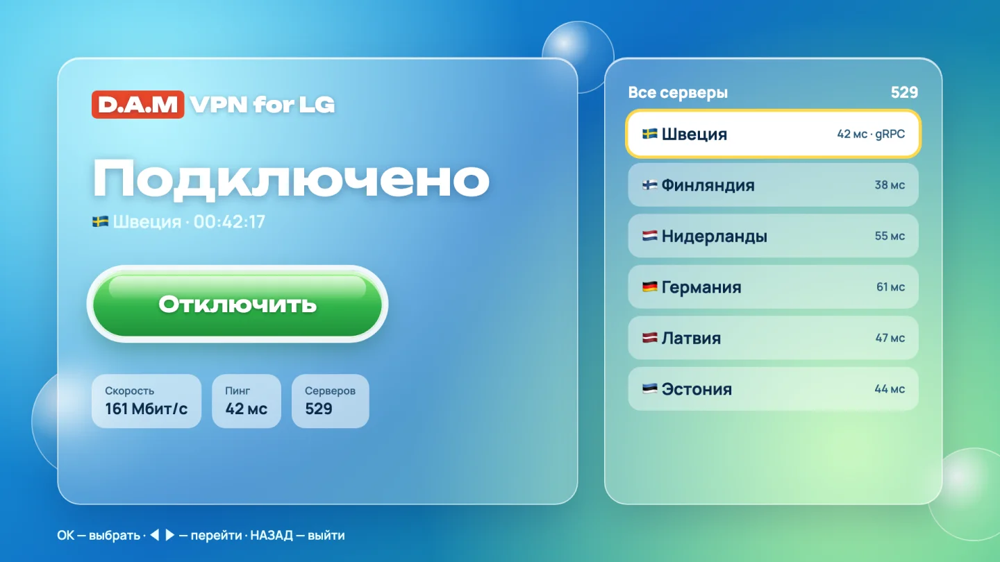
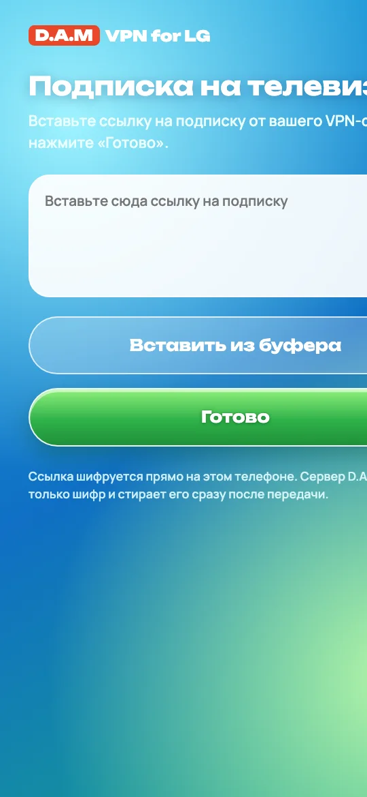

# D.A.M VPN for LG

**Русский** · [English](README.en.md)

VPN для всего телевизора LG на webOS: YouTube, браузер и любые приложения идут через VPN. Подписка любого VPN-сервиса добавляется с телефона по QR-коду — пультом ничего печатать не нужно.

<p> </p>

Страница программы: [damstudio.tech/vpn.html](https://damstudio.tech/vpn.html) · сделано в [D.A.M Studio](https://damstudio.tech)

## Что умеет

- **Весь телевизор через VPN.** Трафик всех приложений уходит в туннель; домашняя сеть, трансляции с телефона и SSH идут напрямую.
- **Адреса сайтов тоже через VPN.** Помогает, когда роутер или провайдер блокирует сайты на уровне DNS (так было с YouTube).
- **Все серверы подписки.** VLESS с REALITY + Vision и с gRPC + TLS; подписка — ссылкой `https://`, списком `vless://` или в base64.
- **Быстро.** На тестовом LG — до 160 Мбит/с через VPN при 176–181 Мбит/с без него.
- **Безопасный откат.** Выключение возвращает сеть телевизора ровно как было; есть автоматический откат, если связь с телевизором пропала.
- **Секреты не утекают.** Ссылка на подписку и ключи не выводятся на экран, в журналы и отчёты; при передаче с телефона ссылка шифруется на самом телефоне.

## Состояние

| Этап | Что | Статус |
|---|---|---|
| 1 | Движок: Xray на ТВ, проверка VLESS + gRPC + TLS | готово, проверено на ТВ |
| 2 | Весь трафик ТВ через VPN (TUN), DNS через VPN, откат | готово, проверено на ТВ |
| 3 | Приложение с интерфейсом «Стекло», подписка по QR, автозапуск, `.ipk` | в работе |

Проверено на LG 86UR81006LA, webOS TV 10.3.2 (webOS 25), root через Homebrew Channel.

Пока приложения нет, VPN включается с Mac командами `tvctl`. Готовый файл для установки на ТВ появится в [Releases](../../releases).

## Что нужно

- Телевизор LG на webOS с root-доступом (Homebrew Channel) и включённым SSH.
- Подписка VPN-сервиса на Xray (VLESS).
- Сейчас — Mac с `python3` и `ssh` в той же сети, что и ТВ.

## Быстрый старт (сейчас, с Mac)

```sh
cd stage1/mac
./tvctl selftest                       # проверка на Mac без ТВ
./tvctl facts                          # сведения о ТВ (только чтение)
./tvctl fetch linux-arm64-v8a          # Xray с проверкой SHA-256

umask 077; mkdir -p ~/.config/lg-tv-vpn
pbpaste > ~/.config/lg-tv-vpn/quattro.uri   # ссылка на подписку из буфера (имя файла историческое)
./tvctl config --list                  # серверы подписки (без секретов)
./tvctl config --pick N                # выбрать сервер
./tvctl tun-config

./tvctl push linux-arm64-v8a && ./tvctl tun-start && ./tvctl tun-check
./tvctl tun-confirm                    # иначе через 5 минут откат сам
./tvctl tun-stop                       # выключить и вернуть сеть как было
```

Адрес ТВ по умолчанию `root@192.168.1.146`, другой — `TV=root@АДРЕС ./tvctl …`. Подробности — [stage1/RUNBOOK.md](stage1/RUNBOOK.md) и [stage2/ПЛАН_TUN.md](stage2/ПЛАН_TUN.md).

## Как устроено

- **Движок** — [Xray-core](https://github.com/XTLS/Xray-core): скачивается из официальных релизов, версия и SHA-256 закреплены в `stage1/mac/fetch_xray.sh`.
- **TUN** `damvpn0` создаёт Xray; трафик направляют отдельная таблица маршрутов и правила `ip rule` с номерами 8991–9004 — основная таблица не меняется.
- **DNS:** на время работы ConnMan спрашивает адреса у Xray на адресе ТВ, Xray отвечает через VPN.
- **IPv6** не выключается, а закрывается маршрутами `unreachable ::/1` и `8000::/1` — так ничего не утекает мимо VPN.
- **Всё временно:** всё живёт в `/tmp` и в памяти ядра, перезагрузка ТВ тоже возвращает сеть.
- **Подписка с телефона** (`stage3/relay/`): страница на damstudio.tech и «почтовый ящик» на PHP. Ключ шифрования — в QR-коде после `#`, на сервер он не попадает; сервер хранит только шифр до 10 минут и отдаёт его один раз.

## Лицензия

Код этого проекта — [MIT](LICENSE).
Xray-core — отдельный проект под лицензией [MPL-2.0](https://github.com/XTLS/Xray-core/blob/main/LICENSE); в репозиторий он не входит и скачивается из [официальных релизов](https://github.com/XTLS/Xray-core/releases), исходный код — там же.

Программа для обхода блокировок и защиты трафика на своём телевизоре. Пользуйтесь в рамках законов своей страны.
